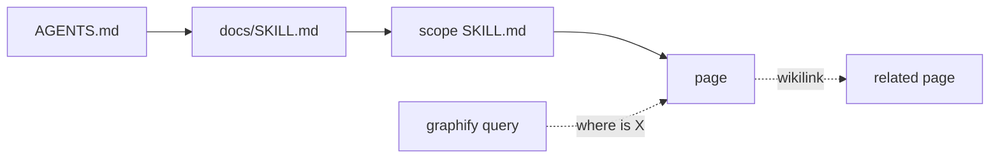

# The documentation encyclopedia

`docs/` is the encyclopedia of yaai.os and the source of truth: rules, specs, invariants, decisions, screens and best
practices. Code reproduces the docs. When code and a doc disagree, the code is wrong (INV-DOCS-001, ADR 0001). A doc
changes only when the user driving the agent decides it; the superseded text moves to `.old/` ([[repo/history]]).

## Scopes and their index

A scope is a folder under `docs/` that owns one area (`repo/`, `adr/`, `invariants/`, `screens/`, ...). Every scope
has a `SKILL.md`: its index and homepage. `docs/SKILL.md` is the root index and routes to every scope index
(INV-DOCS-003). A scope may also hold a `.old/` folder of superseded text ([[repo/history]]).

Scope index template:

```markdown
---
name: <scope-kebab>
description: <What the scope owns>. Use when <trigger>, <trigger>.
tags: [<scope>, index]
---

# <Scope title>

<2-4 lines: what the scope owns and what it solves.>

## Which file to read

| You want to | Read |
| --- | --- |
| <Concrete task, with the words an agent would search for> | [[<scope>/<page>]] |
```

Add nothing else unless every reader of the scope needs it. Keep one row per page and the index short.

## Frontmatter

Every file under `docs/` starts with the short frontmatter (INV-DOCS-002):

```yaml
---
description: One sentence saying what this page answers.
tags: [repo, hooks]
---
```

- `tags` is always a YAML list.
- A `SKILL.md` adds `name: <kebab-case>` first, and its `description` says when to open the scope ("Use when ...").
- A wikilink inside frontmatter is quoted: `superseded_by: "[[repo/hooks]]"`.
- Add another key only when a tool needs it (ADRs carry `status`; `.old/` entries carry `superseded_by` and `commit`).

## Links

`docs/` opens as an Obsidian vault (vault root = `docs/`). `docs/.obsidian/app.json` is committed with absolute link
paths and wikilinks on; workspace files stay ignored. Docs link each other with wikilinks (INV-DOCS-005), always
written as the path from `docs/` without `.md`:

| Form | Use |
| --- | --- |
| `[[repo/hooks]]` | A page |
| `[[repo/hooks#Exit codes]]` | A heading of a page |
| `[[repo/hooks#Exit codes\|exit codes]]` | A heading with display text |
| `[[invariants/SKILL]]` | A scope index: always with the folder, since every scope has a `SKILL.md` |

- Inside a markdown table, escape the alias pipe: `[[repo/hooks\|hooks]]`, or write the link without an alias.
- Files outside `docs/` are repository-relative paths in backticks: `` `tooling/doc-links/src/main.rs` ``.
- External pages are normal markdown links.
- Relative markdown links between docs (`../repo/hooks.md`) are never used: Obsidian and graphify both resolve the
  vault-root form, and `bin/doc-links check` verifies it ([[repo/doc-links]]).

## One subject per page

A page answers one question, named in its `description`. Keep a concept's definition, rules and caveats under one
heading. When a page grows a second subject, split it and add a row to the scope index. Keep pages under about 200
lines. Terms come from [[glossary]] (INV-DOCS-009).

## How an agent finds a page

Agents open docs by task, through indexes (INV-AGENTS-003). Nobody reads the whole folder.



1. `AGENTS.md` points at `docs/SKILL.md`.
2. `docs/SKILL.md` routes the task to one scope index.
3. The scope index routes the task to one page through its `Which file to read` table.
4. The page links related pages with wikilinks; follow only those the task needs.

For "where is X" or "what uses X", query the graph instead of walking indexes ([[repo/graphify]]). graphify makes
each page, heading, wikilink and backticked code path a node or an edge.

## References footer

When the owner gave references for a topic, its page ends with `## References` listing the same references
(INV-DOCS-006), so a later session can fetch current information.

- Prefer a markdown or `llms.txt` version of each page (`https://code.claude.com/docs/en/hooks.md`) and list only that
  URL. Keep the original URL only when no markdown version exists.
- One bullet per reference: `- [Short title](url)`.
- `## References` is the last section of the page.

## The Covers section

A page that governs code lists that code in a `## Covers` section, one repository-relative path per bullet, in
backticks; a directory ends with `/`. The code cites the page back (INV-DOCS-007). The forms and checks are in
[[repo/doc-links]].

## Diagrams

Mermaid graphs are allowed where they explain faster than prose (a flow, a crawl path, a state machine). graphify
skips mermaid blocks, so a link that matters is also written as a wikilink or a code path in prose.

## Add a page

1. Find the scope through `docs/SKILL.md`. Use [[specs/SKILL]] when no scope fits.
2. Check that no existing page answers the same question; extend that page instead when one does.
3. Write the frontmatter, an H1, the content, then `## Covers` and `## References` when they apply.
4. Add one row to the scope `SKILL.md` table.
5. Run `bin/doc-links check`; it exits 0.

## Add a scope

1. Create `docs/<scope>/SKILL.md` from the template above.
2. Add one row for the scope to the table in `docs/SKILL.md`.
3. Add the scope's pages ("Add a page").
4. Run `bin/doc-links check`; it exits 0.

The runtime procedure for any doc change is the `yaai-doc-change` skill (`.agents/skills/yaai-doc-change/SKILL.md`).

## References

- [Writing for agents](https://raw.githubusercontent.com/mattpocock/skills/main/skills/productivity/writing-for-agents/SKILL.md)
- [Obsidian internal links](https://raw.githubusercontent.com/obsidianmd/obsidian-help/master/en/Linking%20notes%20and%20files/Internal%20links.md)
- [Obsidian properties](https://raw.githubusercontent.com/obsidianmd/obsidian-help/master/en/Editing%20and%20formatting/Properties.md)
