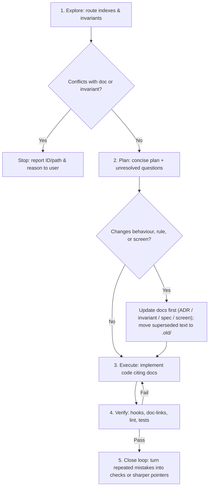

# Agent workflow

This repository is spec-driven and ADR-driven ([[adr/0001-docs-first.adr]], `INV-DOCS-001`): `docs/` is the source of truth, and code exists as its reproduction. When code and a governing doc disagree, the code is wrong.

## Phases: Explore -> Plan -> Execute -> Verify

Every task runs through four phases with clear gates between them:

1. **Explore**: read only the governing docs for the task, routed through indexes (`AGENTS.md` -> [[SKILL]] -> scope `SKILL.md` -> target page). Check [[invariants/SKILL]] for constraints and [[glossary]] for canonical domain terms (`INV-DOCS-009`). Query [[repo/graphify]] before raw file reads.
2. **Plan**: write an extremely concise plan — sacrifice grammar for concision. End every plan with a list of unresolved questions, if any. Resolve conflicts with the user before writing code.
3. **Execute**: update governing docs first, then implement code as their reproduction.
4. **Verify**: run deterministic checks first and report observed command output as evidence.

## The loop in checkable steps

### 1. Locate governing docs by task

- Start at [[SKILL]] and open only the scope index (`SKILL.md`) matching the task (`INV-AGENTS-003`).
- Open the relevant domain files under [[invariants/SKILL]].
- Use [[repo/graphify]] (`graphify query`, `graphify explain`, `graphify path`) to map code and doc relationships before scanning files directly.

### 2. Change docs first when behaviour, rules, or screens change

Update documentation before writing code whenever a task adds or alters behaviour, a rule, or a screen:

| Change kind                                                           | Where it goes                                                                                     |
| --------------------------------------------------------------------- | ------------------------------------------------------------------------------------------------- |
| Hard-to-reverse decision with real trade-offs and non-obvious context | New ADR in [[adr/SKILL]] (only when all three bars hold)                                          |
| Rule that must never break                                            | Invariant in [[invariants/SKILL]]                                                                 |
| Subsystem or repository behaviour                                     | Spec in [[specs/SKILL]] or guide in [[repo/SKILL]]                                                |
| User-facing screen or subview                                         | Implementation-neutral screen doc in [[screens/SKILL]] (`INV-DOCS-008`)                           |
| Superseded text in an existing doc                                    | Move to the scope's `.old/` folder with replacement and commit ([[repo/history]], `INV-DOCS-004`) |

**Authority rule:** a doc changes only because the user driving the agent decided it. If a task conflicts with or is ambiguous against an invariant or governing doc, stop immediately and tell the user which `INV-` / `ADR` / doc path conflicts and why.

### 3. Implement code as a reproduction

- Write code to match the governing doc and follow [[best-practices/SKILL]].
- Cite the governing doc in the comment directly above each governed item (`spec:`, `screen:`, `INV-<DOMAIN>-NNN`, `ADR NNNN`) and keep the doc's `## Covers` section in sync ([[repo/doc-links]], `INV-DOCS-007`).
- Batch independent tool calls through [[repo/psychoscript]] (`INV-AGENTS-004`). Keep context-sharing work in the main session; delegate only under [[repo/delegation]].

### 4. Verify with deterministic checks first

Treat agent output as probabilistic: verify every edit against deterministic pass/fail checks before reporting completion.

- **Tier 1 (deterministic, always first):** agent hooks ([[repo/hooks]]), `bin/doc-links check`, formatter (`oxfmt` / `rustfmt`), linter (`oxlint` / `clippy`), typecheck, and tests. Rules with zero exceptions live in hooks or CLIs that exit `2` with actionable stderr ([[best-practices/tooling-cli.rules]], `INV-TOOLING-001`), never in prose alone.
- **Tier 2 (human judgement):** product direction, invariant changes, and unresolved plan questions go to the user.
- **Tier 3 (black-box review):** use a fresh review sub-agent ([[repo/delegation]]) only where deterministic checks cannot reach, judging from the diff, governing docs, and check outputs.

Report exact commands run and their observed verdicts as evidence.

### 5. Turn repeated friction into permanent checks

When an agent repeats a mistake or the user corrects the same habit twice, convert the lesson into a permanent defence:

1. Add a deterministic check (hook in `.agents/hooks/`, lint rule, `doc-links` check, or test) when the rule has zero exceptions.
2. Sharpen the triggering wording of the relevant index pointer (`SKILL.md` description or routing row) when an agent missed an existing doc ([[repo/writing]]).

Prefer a check or sharper pointer over adding more prose to `AGENTS.md`.

## What counts as done

A task is done only when every condition holds:

- Every behavioural, rule, or screen change landed in `docs/` first, and superseded doc text moved to `.old/`.
- Every governed code item cites its doc and the doc's `## Covers` lists the governed path.
- Every applicable deterministic check (`bin/doc-links check`, format, lint, typecheck, tests) passed after the final edit.
- The final reply states the observed check verdicts, changed files, and any unresolved questions.

## References

- [A complete guide to AGENTS.md](https://www.aihero.dev/a-complete-guide-to-agents-md.md)
- [Building plans you actually read](https://www.aihero.dev/my-agents-md-file-for-building-plans-you-actually-read.md)
- [The AI engineer mindset](https://www.aihero.dev/the-ai-engineer-mindset.md)
- [What are evals](https://www.aihero.dev/what-are-evals.md)
- [How to improve your LLM-powered app](https://www.aihero.dev/how-to-improve-your-llm-powered-app.md)
- [Claude Code best practices](https://code.claude.com/docs/en/best-practices.md)
- [ChatGPT / Codex best practices](https://learn.chatgpt.com/guides/best-practices.md)
- [Codex prompting guide](https://developers.openai.com/cookbook/examples/gpt-5/codex_prompting_guide.md)
- [Antigravity CLI best practices](https://antigravity.google/docs/cli/best-practices.md)
- [Antigravity customization discovery](https://antigravity.google/docs/customization-discovery.md)
- [Domain modeling skill](https://raw.githubusercontent.com/mattpocock/skills/main/skills/engineering/domain-modeling/SKILL.md)
- [Codebase design skill](https://raw.githubusercontent.com/mattpocock/skills/main/skills/engineering/codebase-design/SKILL.md)
- [Claude Code](https://github.com/anthropics/claude-code)
- [wshobson/agents](https://github.com/wshobson/agents)
- [Anthropic cookbooks](https://github.com/anthropics/claude-cookbooks)
- [OpenAI cookbook](https://github.com/openai/openai-cookbook)
- [Brex prompt engineering](https://github.com/brexhq/prompt-engineering)
